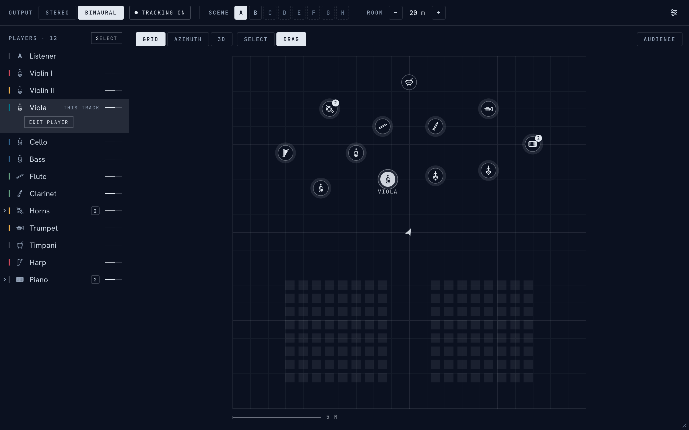
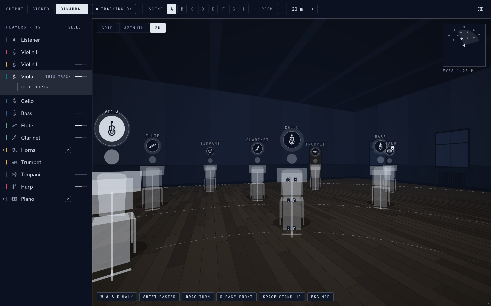

# Composer by Agogica

Composer is an audio plugin for **topophonic composition**: every player (instrument, track) stands somewhere in a virtual room, and you hear the ensemble as it would sound from the listener's seat.
Put it on each track of a score or session, place the players on the map, and listen in stereo or, on headphones, binaurally, optionally with your head tracked by a camera.





**Status: beta.** It is free and open source (AGPL-3.0), VST3 and Audio Unit, for macOS (Apple Silicon) and Windows.

## What it does

- **One plugin per track, one shared stage.**
  Each track gets its own Composer; all of them in a project find each other, so every Composer window shows the whole ensemble and any player can be moved from any window.
  A move writes the owning track's parameters, so automation lands on the right track.
- **Players with several tracks** (a piano's two hands, a desk of horns) stand in one place under one name.
- **Scenes A-H** are alternative layouts of the whole ensemble (places, room, listener) that you switch between.
- **Sound**: each player is delayed and made quieter by its distance, then placed in **Stereo** (constant-power pan) or **Binaural** (the SADIE II KU100 dummy head, a full 360°, for headphones).
  The delay never bends the pitch: a moving player's delay settles and crossfades.
  How much quieter distance makes a player (-2.5 dB per doubling by default), and how far delays are stretched beyond the physical ones (1x to 3x by default), are in the settings.
- **The room in 3D**: walk through the stage at the listener's eyes (W A S D), turn, and hear it turn in Binaural.
- **An audience** can be painted into the room (drawn only).
- **Head tracking**: the companion app Agogica Tracker reads your head's direction from a camera and turns the Binaural scene with it during live playback; exports never depend on the camera.
  It is built from source only for now (see "The Tracker" below).

### Player names

Names come from the host's track name where the host sends one (Ableton Live, REAPER, Cubase).
Dorico and MuseScore cannot give an instrument's name to an effect plugin (Dorico sends "Track N", MuseScore 4 sends nothing, and Audio Units have no track name at all), so there each player is named by hand: "Edit player", or double-click the name.

## Install

Releases are on the [releases page](https://github.com/kulbiq/agogica-composer/releases).
Unzip, then copy:

| | File | To |
|---|---|---|
| macOS | `Composer.vst3` | `~/Library/Audio/Plug-Ins/VST3` |
| macOS | `Composer.component` | `~/Library/Audio/Plug-Ins/Components` |
| Windows | `Composer.vst3` | `%LOCALAPPDATA%\Programs\Common\VST3` |

Then restart the host and add Composer as an insert effect on every track that should stand on the stage.
The Windows build is not signed yet, so Windows may ask before running it.

### Requirements

- macOS on Apple Silicon. The plugins are built to load on macOS 11 and newer, and have been tried on macOS 26 only so far.
- Windows 10 or 11, 64-bit, with the WebView2 runtime (part of Windows 11 and of current Windows 10).
- Development is checked in Dorico 6, MuseScore 4 and Ableton Live 12.

## Build from source

You need CMake 3.22 or newer, Node.js 22, and Xcode (macOS) or Visual Studio 2022 with the C++ workload (Windows).

```sh
git clone --recurse-submodules https://github.com/kulbiq/agogica-composer.git
cd agogica-composer
cmake --preset debug
cmake --build --preset debug
```

On Windows, JUCE also needs the WebView2 SDK where it looks for it, once:

```powershell
nuget install Microsoft.Web.WebView2 -OutputDirectory "$env:USERPROFILE\AppData\Local\PackageManagement\NuGet\Packages"
```

The build makes the VST3, the Audio Unit (macOS) and a Standalone app, builds the editor's page, and installs the plugins per user, without admin rights, into the folders above.
After rebuilding, quit the host completely before trying the new plugin (Dorico's audio engine keeps the old one loaded).
The Tracker is not built unless you ask for it: add `-DCOMPOSER_BUILD_TRACKER=ON` to the first command (it needs Python 3 and downloads ONNX Runtime and the models; on macOS the app is installed to `~/Applications`).

### Tests

```sh
ctest --preset debug -LE slow     # the fast C++ tests; without -LE slow, all of them
(cd ui && npm test)               # the page's tests
scripts/pluginval.sh              # macOS: auval and pluginval at strictness 10
```

## The repository

```
Source/     the plugin: sound (dsp/), what instances share (stage/), the page's C++ side (bridge/), usage data (telemetry/)
ui/         the editor's page: React + TypeScript, drawn with WebGL, embedded in the plugin and served offline
tracker/    Agogica Tracker, the camera head-tracking app
tests/      Catch2 tests
scripts/    release and validation
docs/       DEVELOPMENT.md (how it is built and the rules that matter), HISTORY.md (why), ROADMAP.md (what next)
```

## The Tracker

Agogica Tracker (`tracker/`, its own [README](tracker/README.md)) finds the head with a YOLOX head detector and reads its direction with HFHPE, both run by ONNX Runtime, and shares the direction with Composer through a small file (no network; video never leaves the computer).
It is not part of any release yet: the HFHPE weights carry no stated licence (`tracker/models/MODELS.md`), so they are downloaded only when you build the Tracker yourself.

## Privacy

Composer works offline.
Official releases may ask once whether you want to share anonymous usage data; nothing is sent without a yes, and builds from source never ask.
What is sent, where it goes and how to turn it off: [PRIVACY.md](PRIVACY.md).

## Contributing

Ideas, bug reports and pull requests are welcome: see [CONTRIBUTING.md](CONTRIBUTING.md) and the [code of conduct](CODE_OF_CONDUCT.md).
Security problems are reported privately: [SECURITY.md](SECURITY.md).
What might come next is in [docs/ROADMAP.md](docs/ROADMAP.md).

## Licence and credits

Composer is free software under the GNU Affero General Public License, version 3 ([LICENSE](LICENSE)); every file in this repository is under it unless it says otherwise.
What the plugin contains from others is listed in [THIRD_PARTY_NOTICES.md](THIRD_PARTY_NOTICES.md), and the release zips carry the licence texts.

- [JUCE](https://juce.com) (AGPL-3.0), the framework the plugin is built on.
- The [SADIE II](https://www.york.ac.uk/sadie-project/database.html) database of the University of York (Apache-2.0): the KU100 head-related impulse responses behind Binaural.
- Space Grotesk, Hanken Grotesk and JetBrains Mono (SIL Open Font License), React (MIT).
